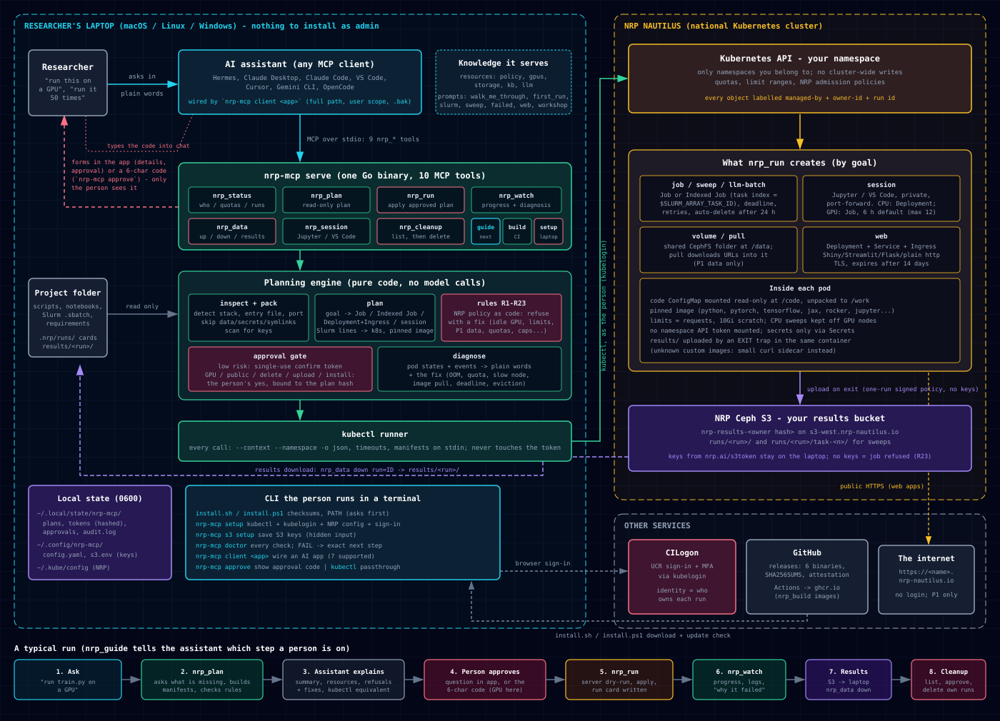

# nrp-mcp

[](https://github.com/UCR-Research-Computing/nrp-mcp/actions/workflows/ci.yml)
[](https://github.com/UCR-Research-Computing/nrp-mcp/actions/workflows/setup-e2e.yml)
[](https://github.com/UCR-Research-Computing/nrp-mcp/releases)
[](go.mod)
[](LICENSE)

**Run your research on the National Research Platform's Nautilus cluster by talking to
your AI assistant.**

**New to Nautilus or Kubernetes? [Start here: one-page setup and first run (docs/START-HERE.md)](docs/START-HERE.md).**

`nrp-mcp` is a small [MCP](https://modelcontextprotocol.io) server that runs on your own
computer. Point it at your Nautilus sign-in and it turns *"here is my code, run it on a
GPU"* into a reviewed plan and a running job. It knows the NRP's rules, so you don't
have to learn Kubernetes first.

```
You:        Run train.py in ~/proj/leafnet on a GPU.
Assistant:  Plan: one Job using pytorch/pytorch, 1 standard GPU, 4 cores, 16 GiB, 24-hour
            limit. It installs requirements.txt and runs `python train.py`. A100s need a
            quota you don't have, so this asks for any free standard GPU. Run it?
You:        Yes.
Assistant:  Waiting for your approval: type the 6-character code from your notification
            or `nrp-mcp approve`.
You:        ABC-234
Assistant:  Running on an RTX A4000... Finished in 41 minutes. Copy results/ back?
```

Built by [UCR Research Computing](https://ucr-research-computing.github.io/). Works with
Hermes Agent, Gemini CLI, OpenCode, Claude Code, Claude Desktop, VS Code, Cursor and any other MCP client.

## Contents

- [Start here (one-page guide)](docs/START-HERE.md)
- [What you can do](#what-you-can-do)
- [Quick start](#quick-start)
- [Plain-language glossary (jargon table)](#plain-language-glossary)
- [The tools](#the-tools)
- [Safety](#safety)
- [Configuration](#configuration)
- [How it works](#how-it-works)
- [Limits](#limits)
- [Development](#development)
- [Help](#help)

## What you can do

| You say | nrp-mcp does |
|---|---|
| "Is my laptop ready for Nautilus?" | Checks kubectl, the sign-in plugin and your NRP config, and installs what's missing (with your yes) |
| "Where do I stand?" | Your namespaces, GPU quotas, what's running, public URLs, and policy warnings |
| "Run this script on a GPU" | Reads your project, picks an image and size, explains the plan, runs it after you agree |
| "Run it 200 times with different seeds" | A parameter sweep (Indexed Job); your script reads its task number |
| "Move my Slurm job here" | Translates `#SBATCH` lines and shows what has no equivalent |
| "Why did it fail?" / "Why is it stuck?" | Plain-language diagnosis with a fix: out of memory, no free GPU, quota, image pull, crashes |
| "Give me a GPU notebook" | A private Jupyter or VS Code session through port-forward |
| "Download this dataset to the cluster" | A shared volume and an in-cluster download, so big files skip your laptop |
| "Put my lab's tool on the web" | Deployment, Service and HTTPS address; suggests names; publishes only after your approval code and expires after 14 days |
| "Containerize this" | A Dockerfile and a GitHub Actions workflow that builds your image on every push (no new account, no keys); NRP GitLab as an option |
| "Deploy the new version" | Updates your running web app in place, same address |
| "Clean up" | Lists what you made and deletes it after your yes (finished runs) or your approval (volumes, web apps, anything running) |

See it applied to real science: [20 research examples](docs/examples/README.md), from bee
repellent screening and climate ensembles to mission records, seismology and econometrics.

## Quick start

For the full one-page walkthrough (including per-OS manual downloads, macOS Gatekeeper,
Windows SmartScreen, approval codes and troubleshooting), read
**[docs/START-HERE.md](docs/START-HERE.md)**.

You need a Nautilus account and a namespace. Sign in once at https://nrp.ai with your
institution and accept the Acceptable Use Policy; students must sign in once before their PI
can add them at https://nrp.ai/namespaces, and faculty/staff/postdocs can request a
namespace there. UCR researchers: see
[Getting access](https://ucr-research-computing.github.io/kb/kb024-nautilus-getting-access/).

**1. Install nrp-mcp**

Linux or macOS:

```bash
curl -fsSL https://raw.githubusercontent.com/UCR-Research-Computing/nrp-mcp/main/scripts/install.sh | sh
```

Windows (PowerShell):

```powershell
irm https://raw.githubusercontent.com/UCR-Research-Computing/nrp-mcp/main/scripts/install.ps1 | iex
```

Or download the archive for your OS (`darwin_arm64`, `darwin_amd64`, `windows_amd64`,
`windows_arm64`, `linux_amd64`, `linux_arm64`) from
[Releases](https://github.com/UCR-Research-Computing/nrp-mcp/releases); see
[docs/START-HERE.md](docs/START-HERE.md) for macOS Gatekeeper and Windows SmartScreen steps.
With Go installed, `go install github.com/UCR-Research-Computing/nrp-mcp/cmd/nrp-mcp@latest`
works everywhere.

**2. Download your NRP config** at https://nrp.ai/config (it lands in Downloads).

**3. Get your computer ready (and optional S3 results)**

```bash
nrp-mcp setup
nrp-mcp s3 setup   # optional once: paste keys from https://nrp.ai/s3token/ to save job results
```

`setup` checks everything first and asks before changing anything. Then it installs kubectl
and the kubelogin sign-in plugin (official releases, SHA256-checked, into your user folder,
no admin rights), puts the NRP config in `~/.kube/config` (backing up an existing one), and
signs you in through your browser. Check readiness at any time with `nrp-mcp doctor`.

**4. Add it to your AI client**

Run `nrp-mcp client <name>` once in your terminal:

```bash
nrp-mcp client claude-desktop   # or: claude-code, vscode, cursor, gemini, opencode, hermes
```

It writes your user-scope client configuration with the full path to `nrp-mcp` and `["serve"]`,
backs up any existing config file to `.bak`, and tells you to restart the app. Pass
`--namespace <your-namespace>` to pin a default namespace.

Tested end to end (live cluster, Gemini API key) with each of these:

| Client | Automatic (`nrp-mcp client`) | Manual CLI / config |
|---|---|---|
| [Hermes Agent](https://hermes-agent.nousresearch.com/) | `nrp-mcp client hermes` (`~/.hermes/config.yaml`) | `hermes mcp add nrp --command /full/path/to/nrp-mcp --args serve` |
| [Gemini CLI](https://github.com/google-gemini/gemini-cli) | `nrp-mcp client gemini` (`~/.gemini/settings.json`) | `gemini mcp add --scope user nrp /full/path/to/nrp-mcp serve` |
| [OpenCode](https://opencode.ai/) | `nrp-mcp client opencode` (`~/.config/opencode/opencode.json`) | `"mcp": {"nrp": {"type": "local", "command": ["/full/path/to/nrp-mcp", "serve"], "enabled": true}}` |
| Claude Code | `nrp-mcp client claude-code` (`~/.claude.json`) | `claude mcp add --scope user nrp -- /full/path/to/nrp-mcp serve` |
| Claude Desktop | `nrp-mcp client claude-desktop` | `mcpServers` in `claude_desktop_config.json` |
| Cursor | `nrp-mcp client cursor` (`~/.cursor/mcp.json`) | `mcpServers` in `~/.cursor/mcp.json` |
| VS Code | `nrp-mcp client vscode` (`User/mcp.json`) | `"servers": {"nrp": {"type": "stdio", "command": "/full/path/to/nrp-mcp", "args": ["serve"]}}` |

**5. Ask:** *"Where do I stand on Nautilus?"*

### Plain-language glossary

| Term | What it means |
|---|---|
| **pod** | One running copy of your program on a cluster machine (1 pod for a job; up to `parallel` pods at once for a sweep). |
| **namespace** | Your group's shared project space on Nautilus (for example `ucr-research-computing`). `nrp-mcp` labels your objects with your identity so cleanup only touches your own runs. |
| **volume** | A persistent shared folder on the cluster (`PersistentVolumeClaim`, mounted at `/data`) that stays after a job finishes. Untouched volumes can be purged after 6 months. |
| **public URL** | An `https://<name>.nrp-nautilus.io` web address reachable without login (`goal=web`). Needs your approval code to publish, serves P1 data only, and expires after 14 days (the NRP 2-week Deployment rule). |
| **P1** | Public or low-risk non-sensitive data (UC Protection Level 1). Allowed on Nautilus. Personal, student (FERPA), patient/clinical (HIPAA), controlled genomic, or restricted DUA data is **not** P1 and must never be used on Nautilus. |

### A bigger app (your code on GitHub)

1. In your project folder: *"Containerize this."* nrp suggests a Dockerfile (keeps yours if you
   have one) and `.github/workflows/nrp-image.yml`.
2. Commit and push. GitHub builds the image (Actions tab) and saves it as
   `ghcr.io/<owner>/<repo>`, private at first. It uses GitHub's built-in token: no secrets to add.
3. Make the package public (Packages, Package settings, Change visibility), or keep it private and
   store a read-only `read:packages` token once as a pull secret (nrp explains both).
4. *"Put it on the web with image ghcr.io/<owner>/<repo>:<commit>."* nrp plans it, you approve it
   with your approval code (`nrp-mcp approve`), and it goes live.
5. New version: push, wait for the build, then *"deploy the new version"*. The running app is
   updated in place at the same address.

## The tools

Ten tools, each named for what you want rather than for Kubernetes objects. Every result
starts with a plain-language summary and, where useful, the `kubectl` equivalent so you
learn as you go.

| Tool | Changes things? | What it does |
|---|---|---|
| `nrp_guide` | no | Walks you through step by step: checks your computer, sign-in, namespace, saving results and your runs, and tells your assistant the one next step and the question to ask you (new in 1.1; or use the `walk_me_through` prompt) |
| `nrp_setup` | only with `fix=true` | Laptop readiness: kubectl (version vs the cluster), kubelogin, NRP config, sign-in; installs or updates them with your yes |
| `nrp_status` | no | Identity, namespaces, GPU quotas, workloads and what they ask for, volumes, public URLs, warnings |
| `nrp_plan` | no | Asks you for anything missing in one short form if your AI app can show one (folder, goal, which file, GPU or not, results), then inspects a project and a goal (`job`, `sweep`, `web`, `session`, `llm-batch`, `volume`, `pull`), applies every rule, returns a summary, decisions, refusals, `resources`, the files it will copy and skip, and either a confirm token or `needs_person_approval` (full manifests with `show_manifests=true`) |
| `nrp_run` | yes, after the person approves (question or code) or with a token for low-risk plans | Runs an approved plan; risky plans take the person's `approval_code`; writes a private run card to `<project>/.nrp/runs/` |
| `nrp_watch` | no | Progress, logs (tail/grep), diagnosis with a fix, public URL check |
| `nrp_cleanup` | yes, two steps | Lists your runs, then deletes one after a second confirm |
| `nrp_session` | no | Readiness, port-forward command and local link for a notebook or VS Code session (GPU sessions run as Jobs with a time limit, default 6 hours) |
| `nrp_data` | uploads only | List, upload small non-sensitive files, download results from a volume, or a job's saved results with `down run=<id>` |
| `nrp_build` | no | Suggests a Dockerfile and a GitHub Actions workflow that builds it into ghcr.io (or, with `target=gitlab`, an NRP GitLab kaniko file); explains public vs private images |

Also served: resources `nrp://policy`, `nrp://gpus`, `nrp://storage`, `nrp://llm`,
`nrp://kb`, and prompts `first_run`, `port_slurm_script`, `parameter_sweep`,
`my_job_failed`, `host_web_tool`, `teach_workshop`.

## Safety

- **Runs as you, on your computer.** It uses your kubeconfig and the NRP's own sign-in. It
  never reads or stores your token, and nothing leaves your computer except the Kubernetes
  calls you approve.
- **Nothing happens without a yes.** Planning creates nothing. Risky steps need your own
  approval (see below); other runs need a single-use token bound to the exact plan, valid
  for 10 minutes.
- **Nothing goes public by accident.** A web plan publishes only after you approve it, and
  public apps expire after 14 days.
- **The NRP rules are built in**, each with a test and a link to its source:
  - non-sensitive data only
  - Jobs instead of sleep loops
  - limits within 20% of requests
  - quota-gated GPUs (A100/H100/H200/GH200)
  - no GPUs on long-running services
  - allowed priority classes only
  - secrets kept out of specs (other users can see specs)

  A plan that breaks a rule is refused, with the reason and the fix.
- **Shared namespaces are safe.** Every object is labelled with its owner, and cleanup only
  sees your own runs unless you are the namespace admin and ask for everyone's.
- **Caps** on pods and GPUs running at once, tasks per sweep, and hours per run.
- **Audit log** of every change at `~/.local/state/nrp-mcp/audit.log`.
- **Setup only touches your user folder.** kubectl and kubelogin go into `~/.local/bin`
  (Windows: `%LOCALAPPDATA%\Programs\nrp-mcp\bin`). They come only from dl.k8s.io and the
  kubelogin GitHub releases, and only when the published SHA256 matches.

See [SECURITY.md](SECURITY.md) for details and how to report a problem.

### Approving risky steps

Public web apps, GPU work, deleting volumes or anything still running, uploading and
installing need your approval, not the AI's. If your AI app can ask you a question (a
yes/no prompt is enough), nrp-mcp asks you directly. Otherwise it shows you a short code,
for example ABC-234, in a desktop notification (with a sound on macOS) and in
`nrp-mcp approve` (run it in your own terminal). Removing a finished run with no volumes
loses nothing, so your "yes" in the chat is enough for that. Type the code into the chat; the assistant passes it as
`approval_code`. Codes work once, for that plan only, for 10 minutes. Never share a code
with anyone, and never paste one you did not ask for.

### Keeping results

Run `nrp-mcp s3 setup` once in your own terminal (it asks for your keys from
https://nrp.ai/s3token/). Then anything your job writes to `results/` is saved to your own NRP
S3 bucket when the job ends. Ask for it back with `nrp_data action=down run=<id>`; it lands
in `<project>/results/<run>/`. Without this setup, nrp-mcp will not start a job until you
say "yes, discard results".

## Configuration

All optional. `nrp-mcp init` writes an example to `~/.config/nrp-mcp/config.yaml`:

```yaml
kubeconfig: ~/.kube/config    # the NRP config from https://nrp.ai/config
context: nautilus
namespace: my-lab             # default namespace
kubectl: kubectl              # full path if kubectl is not on PATH
pods_per_run: 50              # pods at the same time; plans over these caps are refused
gpus_per_run: 4               # GPUs in use at the same time
namespace_gpus: 8             # max GPUs in running pods across the namespace
tasks_per_run: 10000          # total tasks in one sweep
hours_per_run: 48
gpu_session_hours: 6          # GPU sessions run as Jobs and stop after this many hours (max 12)
upload_gb_per_run: 50
```

Environment overrides: `NRP_KUBECONFIG`, `NRP_CONTEXT`, `NRP_NAMESPACE`, `NRP_KUBECTL`.
Command-line flags for `serve`, `setup` and `doctor`: `--kubeconfig`, `--context`,
`--namespace`, `--config`.

| Command | What it does |
|---|---|
| `nrp-mcp serve` | The MCP server on stdio (what your AI client starts) |
| `nrp-mcp setup` | Check and ready this computer (asks first; `--yes` to skip the question, `--no-sign-in` to stop before the browser) |
| `nrp-mcp doctor` | Check kubectl, sign-in, namespaces and quotas |
| `nrp-mcp init` | Write an example config (never overwrites) |
| `nrp-mcp approve` | Show the current approval code (run it in your own terminal) |
| `nrp-mcp s3 setup` | Save your NRP S3 keys for job results (hidden input, file 0600) |
| `nrp-mcp client <name>` | Add nrp-mcp (user scope, full binary path) to `claude-desktop`, `claude-code`, `vscode`, `cursor`, `gemini`, `opencode`, or `hermes` (keeps `.bak`) |
| `nrp-mcp kubectl ...` | Run the installed `kubectl` with the NRP kubeconfig and context |
| `nrp-mcp version` | Print the version |

## How it works



The same, in short:

```
AI client (Hermes Agent, Gemini CLI, OpenCode, Claude Code, ...)
   | MCP over stdio
nrp-mcp serve                    on your computer
   |-- inspect   reads your project folder (language, GPU use, entry point, web app, Slurm script)
   |-- plan      builds manifests from facts + goal (pure, tested)
   |-- rules     checks every NRP policy (pure, tested)
   |-- store     plans, hashed confirm tokens, audit log
   `-- kube      runs kubectl as you (kubelogin handles the sign-in)
   |
Nautilus (Kubernetes): Jobs, Deployments, volumes, Ingress in your namespace
```

Small projects are copied into the pod as a ConfigMap and their requirements installed at
start. Bigger ones get an image: `nrp_build` writes a GitHub Actions workflow, GitHub builds
the image on every push into its container registry (ghcr.io), and `nrp_plan image=...` deploys
it as built. A private image needs `pull_secret=` (a read-only token stored once in your
namespace); a public one needs nothing. The full design, every
rule and the test record are in [SPEC.md](SPEC.md).

## Limits

- Code is copied as text files under 200 KB each (900 KB total). Bigger projects need an
  image (`nrp_build`) or git.
- `nrp_build` suggests files; it doesn't build. Builds run on GitHub Actions (or NRP GitLab).
- Job results written to `results/` (or new files in `/work`) are saved to your personal NRP
  S3 bucket once you run `nrp-mcp s3 setup` with keys from https://nrp.ai/s3token/; moving
  very large external datasets into S3 uses standard S3 tools.
- Sessions are port-forwarded (`nrp-mcp kubectl ... port-forward`) and never public. For zero
  install, the NRP runs a hosted JupyterHub at https://jupyterhub-west.nrp-nautilus.io.
- `nrp-mcp setup` and the installers (`install.sh`, `install.ps1`) are tested on Linux,
  Windows and macOS in CI on every change; the browser sign-in step can't run in CI and is
  tested by hand. Please [report](https://github.com/UCR-Research-Computing/nrp-mcp/issues)
  anything that goes wrong.

## Development

```
bash scripts/gauntlet.sh                                 # gofmt, vet, tests, build (same as CI)
go build -o nrp-mcp ./cmd/nrp-mcp
go run ./scripts/e2e  -bin ./nrp-mcp -ns <namespace>     # live: job, sweep, web plan, cleanup
go run ./scripts/e2e2 -bin ./nrp-mcp -ns <namespace>     # live: volume, data, Jupyter, cleanup
```

The live tests create small, labelled, CPU-only workloads and clean them up; they never
create GPU pods or public endpoints. See [CONTRIBUTING.md](CONTRIBUTING.md) and
[CHANGELOG.md](CHANGELOG.md). Example app: [examples/leaf-area-explorer](examples/leaf-area-explorer).

## Help

- First-time setup and troubleshooting: [docs/START-HERE.md](docs/START-HERE.md) (and run
  `nrp-mcp doctor` to check your setup)
- Questions and bugs: [GitHub issues](https://github.com/UCR-Research-Computing/nrp-mcp/issues)
- UCR researchers: research-computing@ucr.edu and the
  [Nautilus guides](https://ucr-research-computing.github.io/kb/kb023-nautilus-researcher-guide/)
- The cluster itself: https://nrp.ai/contact (NRP Matrix community support chat)

Nautilus is operated by the National Research Platform (UC San Diego / SDSC). This is a
community tool from UCR Research Computing, not an NRP product. Please follow the
[NRP policies](https://nrp.ai/documentation/userdocs/start/policies/).

## License

[MIT](LICENSE)
